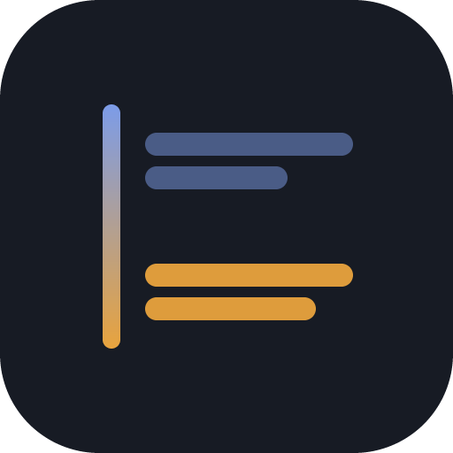

<div align="center">



# LM Translate

**Translate anything on your screen with one keypress.**

Select text in any application and press a hotkey, or drag a box over any part of the
screen — including text inside images and video — and read the translation in a small
popup that appears where you are already looking.


</div>

---

## What it does

| Hotkey | Flow |
|---|---|
| `Alt+D` | **Select and translate.** Highlight text anywhere, press the key, read the translation. |
| `Alt+S` | **Screenshot and translate.** Press the key, drag a box over anything on screen, read the translation. |

Neither flow has an icon to click or a confirmation step: the hotkey *is* the trigger,
and releasing the drag *is* the trigger. Both hotkeys are configurable.

It runs in the system tray with no main window, and behaves identically no matter which
application is in the foreground — browser, native app, IDE, terminal, PDF viewer.

### Features

- **Works anywhere.** Nothing to install into the browser or the editor.
- **Reads pixels, not just text.** The screenshot flow OCRs and translates in one call,
  so it handles text in images, video frames and canvases.
- **Bring your own model.** MiniMax over either of its two APIs, or any
  OpenAI-compatible or Anthropic-compatible endpoint. Base URL and model name are
  editable, so a model bump needs no rebuild.
- **Your clipboard is left alone.** It is saved before the copy step and restored after.
- **Your key stays local.** Stored in a plain file next to the settings, never logged,
  sent only to the endpoint you configured.
- **Instant repeats.** A per-session cache makes re-translating the same text free.
- **Keyboard-first.** Every surface closes on `Esc`, and every control has a visible
  focus ring.

---

## Install

Grab an installer from `src-tauri/target/release/bundle/` after building, or build and
run from source:

```sh
npm install
npm run tauri dev        # development, with hot reload
npm run tauri build      # release binary + MSI/NSIS/DEB/DMG installers
```

### Requirements

| | |
|---|---|
| **All platforms** | [Rust](https://rustup.rs) 1.85+, [Node](https://nodejs.org) 20+ |
| **Windows** | Visual Studio Build Tools with the C++ workload; WebView2 runtime (preinstalled on Windows 11 and current Windows 10) |
| **macOS** | Xcode command line tools |
| **Linux** | `webkit2gtk-4.1`, `libayatana-appindicator3`, `librsvg2`, `libxdo`, `libssl-dev`, plus `xdg-desktop-portal` on Wayland |

On Debian/Ubuntu:

```sh
sudo apt install libwebkit2gtk-4.1-dev libayatana-appindicator3-dev librsvg2-dev \
                 libxdo-dev libssl-dev build-essential curl file
```

### Command line flags

```sh
lmtranslate --settings    # start with Settings open (useful for a desktop shortcut)
lmtranslate --self-test   # exercise the popup at every screen edge, then probe both
                          # capture backends, writing results to the log
```

Run `--self-test` against a **release** build. Its selection probe sends a real `Ctrl+C`,
and a debug build has a console attached that will take the keystroke as an interrupt if
it happens to hold focus. Release builds have no console.

---

## First run

Open **Settings** from the tray icon and fill in the Provider section:

- **Provider** — defaults to *MiniMax (Anthropic API)*. See
  [Which API shape](#which-api-shape) for why.
- **Base URL** — defaults to `https://api.minimax.io/anthropic`.
- **Model name** — defaults to `MiniMax-M3`.
- **API key** — masked. **Test connection** does a cheap round trip and reports pass or
  fail inline instead of saving silently.

Target language, both hotkeys, launch-on-login, popup auto-close and theme are all
optional and persist across restarts.

### Where your files live

One folder, named after the app:

| | |
|---|---|
| Windows | `%APPDATA%\LMTranslate\` |
| macOS | `~/Library/Application Support/LMTranslate/` |
| Linux | `~/.config/LMTranslate/` |

containing `settings.json` and `logs/lmtranslate.log`. Tauri's `app_config_dir()` would
have appended the whole reverse-DNS bundle identifier here, putting vendor branding into
a path you have to read; the app resolves its own folder instead. Settings written by a
build that used an older identifier are migrated forward on first run, so upgrading does
not cost you the API key.

Both paths are shown at the bottom of **Settings → Advanced**, where the log can be
viewed and cleared. The log holds request and response *metadata* only — never the API
key, never the text being translated.

---

## Speed

Time to a result is dominated by one thing: **how many tokens the model generates.**
Everything the app itself does — grabbing the selection, capturing the screen, opening
the popup — is tens of milliseconds. So every lever is about generating less:

- **The translation only, never an echo of the source.** Asking the model to repeat the
  original text back alongside each translation roughly doubles the generated tokens, and
  the app already has the original. Text mode does not ask for it. Image mode still
  returns the source text, because there it is the OCR result and genuinely new.
- **A per-request output budget** scaled from the input length rather than a flat
  maximum, so a model that starts rambling cannot hold the popup open for the full
  45-second timeout.
- **A session cache.** Re-translating the same text into the same language is instant and
  makes no network call. Cleared automatically when you change provider or model, so a
  stale model's output is never served. Image input is not cached.
- **Reasoning models are the other half of the bill.** MiniMax-M3 thinks before it
  answers, and you wait through those tokens. The log tells you where the time went:

  ```
  translate ok kind=text segments=1 chars=48 raw=91B tokens[in=612 out=37] in 1840ms
  ```

  A large `out=` relative to `chars=` means the model spent its time deliberating. A
  smaller or non-reasoning model in **Settings → Model name** is the fix.

The next lever would be **streaming**, which would not reduce total time but would start
showing the translation as it arrives. It is not implemented — it needs incremental
parsing of a partial JSON envelope, and it is not worth building against latency that
has not been measured.

---

## Which API shape

MiniMax exposes the same models over two different HTTP contracts, and LM Translate
implements both behind one `TranslateProvider` trait. The choice matters for a concrete
reason: **where the model's chain-of-thought ends up.** MiniMax-M3 is a reasoning model,
so it deliberates before answering.

| | `…/anthropic` (Messages) | `…/v1` (OpenAI chat) |
|---|---|---|
| Reasoning arrives as | a separate `thinking` **content block** | `<think>…</think>` inlined in the answer |
| Getting the answer out | read the `text` blocks, ignore the rest | strip the tags out of the text |
| A leak is | structurally impossible | prevented by string surgery |
| JSON discipline | prompt + parser | `response_format: json_object` + parser |
| `max_tokens` | required | optional |
| System prompt | a top-level `system` field | a pseudo-message |

The Anthropic shape is the default because reading typed blocks cannot fail the way
tag-stripping can — reasoning reaching the popup was a real bug on the OpenAI path. The
OpenAI-shaped entries stay because that contract is the lingua franca of self-hosted
servers (vLLM, Ollama, LM Studio) and proxies.

Both transports feed the same hardened parser, so `<think>` handling and the
prefer-the-last-JSON-block rule apply on either path. Each provider keeps its own key,
base URL and model, so switching between them costs no retyping.

### Tuning translation quality

The knobs are in [`src-tauri/src/translate/prompts.rs`](src-tauri/src/translate/prompts.rs)
— one system prompt, one template per mode, and the temperature. They ask for idiomatic
phrasing explicitly and tell the model to segment by **paragraph** rather than by
sentence, so it has enough context to write what a native speaker would. A bare
"translate this" instruction reliably produces word-for-word output.

Model choice matters at least as much as the prompt. If output is still literal, try a
larger model before editing prompts.

---

## How it works

"Grab the current selection" and "capture a screen region" genuinely need different code
per platform, so each has its own backend behind one trait. **Settings → Advanced** always
shows which backend is active and what it can do on the current session.

| Platform | Selection | Capture |
|---|---|---|
| **Windows** | synthetic `Ctrl+C`, clipboard saved and restored | Desktop Duplication |
| **macOS** | synthetic `Cmd+C`, clipboard saved and restored | CoreGraphics |
| **Linux / X11** | **PRIMARY selection** — nothing simulated, clipboard untouched | XCB |
| **Linux / Wayland** | **primary-selection protocol** — no synthetic input is possible | `xdg-desktop-portal` |

A detail worth knowing: a global hotkey fires on key-*down*, so `Alt` is still held when
the copy chord goes out. Sending `Ctrl+C` then would be read as `Ctrl+Alt+C`, which is not
"copy" anywhere — and releasing `Alt` on its own opens the window menu, moving focus off
the selection. The copy modifier is therefore pressed *first*, which makes the `Alt`
release non-lone and satisfies both constraints.

On macOS the first run needs **Accessibility** (to send the copy chord) and **Screen
Recording** (to capture) in System Settings → Privacy & Security. Settings → Advanced has
a button that opens the right pane.

Wayland sandboxes both input injection and screen capture, so it is a separate
implementation rather than a variant. There is no synthetic `Ctrl+C`; highlighted text is
read from the primary selection, which GNOME and KDE both implement and which needs no
permission prompt. On a compositor without it the popup says so plainly instead of
hanging. Capture goes through the portal, so the compositor shows its own consent dialog.
Your clipboard is never modified on Wayland. X11 versus Wayland is detected at startup
from `XDG_SESSION_TYPE`, falling back to `WAYLAND_DISPLAY`.

### Project layout

```
src/                          frontend — three small documents, no framework
  popup.{html,ts}             the only result window (loading / result / error)
  crop-overlay.{html,ts}      fullscreen drag-to-select, one per monitor
  settings.{html,ts}          single-column grouped settings
  styles/tokens.css           design tokens and the gloss rail

src-tauri/src/
  main.rs                     entrypoint, tray icon, plugins
  hotkeys.rs                  registration, dispatch, conflict probing
  flows.rs                    end-to-end orchestration for both triggers
  commands.rs                 everything the webviews can call
  config.rs  state.rs  logger.rs  demo.rs
  platform/                   one backend per platform behind PlatformCapture
  capture/                    text_selection.rs, screenshot.rs
  translate/                  provider.rs (trait), client.rs (OpenAI shape),
                              anthropic.rs (Messages shape), prompts.rs, cache.rs
  windows/                    popup_window.rs, crop_overlay.rs, settings_window.rs
```

[DESIGN.md](DESIGN.md) documents the interface design — the palette, the type system and
the gloss rail that binds the original and translated text into one unit.

`assets/logo.svg` is the mark; `node scripts/make-icon.mjs [size] [out]` renders it to
PNG (a hand-rolled encoder, no image dependency), and `npx tauri icon app-icon.png`
produces the platform icon set.

---

## Development

```sh
cd src-tauri && cargo test    # model-reply parsing, reasoning stripping, endpoint
                              # construction, cache eviction
npm run build                 # strict TypeScript typecheck + production bundle
```

### Known limitations

Stated plainly rather than discovered later:

- **No live API call has been verified.** The transports, prompts and token accounting
  are implemented and unit-tested against recorded response shapes, but no request has
  been made to a real endpoint. The Anthropic path's URL layout and auth headers are
  inferred from that contract.
- **The Wayland backends are the least exercised code here.** They compile only on Linux
  and have not been run against GNOME or KDE.
- **No streaming**, so the popup shows a loading state until the whole reply arrives.
- **Milestone 8 — hotkey-free selection detection** (UI Automation, AXUIElement, AT-SPI)
  is not implemented; the hotkey remains the trigger on every platform.
